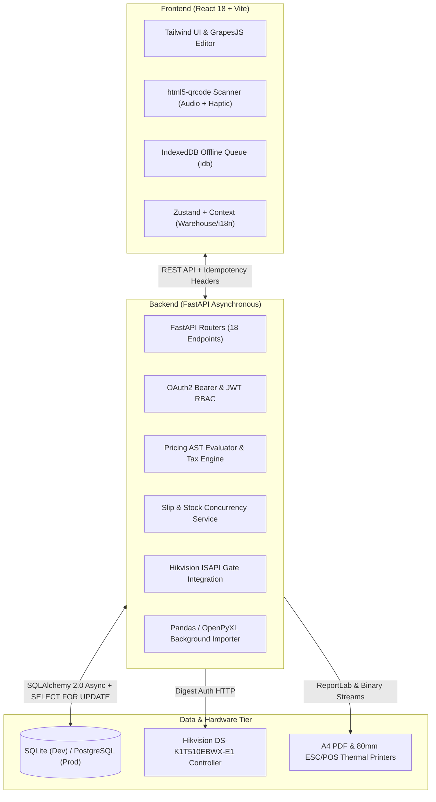

# Warehouse Inventory & Gate-Pass System: Project Architecture & Codebase Analysis

> [!NOTE]
> **Project Scope:** Full-stack warehouse inventory, gate-pass management, barcode scanning, and sales proposal platform designed for offline-first resilience, strict concurrency safety, and industrial hardware integration.

---

## 1. System Overview & Technology Stack

The project is structured as a decoupled full-stack monorepo featuring a high-performance Python asynchronous API and a modern single-page React frontend.



### Technology Breakdown

| Component | Technology | Purpose / Role |
| :--- | :--- | :--- |
| **Backend Framework** | [FastAPI](file:///d:/warehouse-system/backend/app/main.py#L30) (0.115.0) + Uvicorn | Asynchronous HTTP API with OpenAPI documentation |
| **Database ORM** | [SQLAlchemy](file:///d:/warehouse-system/backend/app/core/database.py) (2.0.35) Async | Declarative models with row-level locks and `selectinload` |
| **Migrations** | [Alembic](file:///d:/warehouse-system/backend/alembic/env.py) (1.13.2) | Schema versioning and async migrations |
| **Security & Auth** | [passlib (bcrypt)](file:///d:/warehouse-system/backend/app/core/security.py#L8) + `python-jose` | Salted password hashing & signed JWT tokens |
| **Reporting & Export** | `reportlab`, `pandas`, `openpyxl`, `jinja2` | A4 PDF generation, Excel/CSV bulk import/export, HTML rendering |
| **Frontend Framework** | [React 18](file:///d:/warehouse-system/frontend/src/main.tsx) + [Vite 5](file:///d:/warehouse-system/frontend/vite.config.ts) | High-performance SPA with TypeScript |
| **Styling & Theme** | Tailwind CSS 3.4 + Dark Mode | Curated slate-based design system with responsive sidebar |
| **Offline Storage** | [idb (IndexedDB)](file:///d:/warehouse-system/frontend/src/offlineQueue.ts#L1) | Persistent offline scan queue with auto-retry and sync |
| **Hardware Scanning** | `html5-qrcode` + Web Audio API | Live camera barcode reading with beep sound and haptic vibration |
| **Document Builder** | `grapesjs` + `grapesjs-preset-webpage` | Visual drag-and-drop proposal layout designer |

---

## 2. Directory Structure & Key Modules

```
d:/warehouse-system/
├── backend/
│   ├── alembic/                 # Database schema migrations
│   ├── app/
│   │   ├── api/                 # 18 Modular FastAPI routers
│   │   │   ├── auth.py          # JWT login & token lifecycle
│   │   │   ├── bulk.py          # Background CSV/Excel upload
│   │   │   ├── currencies.py    # Multi-currency exchange rate manager
│   │   │   ├── customers.py     # CRM customer records
│   │   │   ├── cycle_counts.py  # Physical inventory audit & reconciliation
│   │   │   ├── einvoice.py      # Turkish UBL-TR e-invoice export stub
│   │   │   ├── labels.py        # Barcode sticker PDF generator
│   │   │   ├── notifications.py # Notification feed & badge counter
│   │   │   ├── pricing.py       # Price lists, matrix & tax rates
│   │   │   ├── procurement.py   # Purchase orders & goods receipt
│   │   │   ├── products.py      # Catalog & SKU management
│   │   │   ├── proposals.py     # Quote creation, Jinja rendering & slip conversion
│   │   │   ├── reports.py       # Stock balance & full audit log exports
│   │   │   ├── slips.py         # Gate passes, verify terminal & dual print
│   │   │   ├── stocks.py        # Atomic stock adjustments & transfers
│   │   │   ├── uploads.py       # Product images static handler
│   │   │   └── warehouses.py    # Multi-warehouse management & gate config
│   │   ├── core/                # Configuration, database, security, logging
│   │   ├── models/              # 15 SQLAlchemy ORM models
│   │   ├── schemas/             # Pydantic v2 validation contracts
│   │   └── services/            # Pure business logic (locking, printing, QR, gate ISAPI)
│   └── tests/                   # Python test suite
├── frontend/
│   ├── src/
│   │   ├── components/          # GrapesJS visual editor & rich text editor
│   │   ├── pages/               # 19 Dedicated functional views
│   │   ├── i18n/                # Dual language support (EN / TR)
│   │   ├── offlineQueue.ts      # IndexedDB scan queue worker
│   │   ├── warehouseContext.tsx # Global active warehouse selector state
│   │   └── api.ts               # Axios interceptors with JWT token injection
│   └── public/                  # Manifest and PWA service worker (sw.js)
├── scripts/
│   ├── seed.py                  # Database bootstrapper with realistic demo data
│   └── backup.sh                # Shell backup utility
└── docker-compose.yml           # PostgreSQL 16 + API container orchestration
```

---

## 3. Core Functional Domains

### 3.1. Concurrency Safety & Stock Reservation
- **Row-Level Locking:** Stock adjustments in [`stock_service.py`](file:///d:/warehouse-system/backend/app/services/stock_service.py#L46-L53) execute `select(Stock).where(...).with_for_update()`, preventing concurrent overselling and race conditions under heavy load.
- **Deadlock-Free Transfers:** When transferring between two warehouses in [`stocks.py`](file:///d:/warehouse-system/backend/app/api/stocks.py#L151), locks are ordered by `min(warehouse_id)` and `max(warehouse_id)`.
- **Three-Stage Reservation Lifecycle:**
  1. **Proposal Conversion:** Converts proposal to a `DRAFT` outbound slip and locks `reserved += qty` without decrementing physical `quantity`.
  2. **Confirmation:** Consumes the reservation and deducts `quantity = on_hand - qty`.
  3. **Cancellation:** Safely decrements `reserved` without touching physical stock.

### 3.2. Offline-First Mobile Scanner
- [Scanner.tsx](file:///d:/warehouse-system/frontend/src/pages/Scanner.tsx) interfaces with the device camera via `html5-qrcode`.
- On scan, it emits an 880Hz audio tone via Web Audio API and triggers device vibration (`navigator.vibrate`).
- If network connection drops:
  - Scans are persisted to IndexedDB (`warehouse-offline`) with a client-generated UUID `idempotencyKey`.
  - When connection is restored (`window.ononline`), [offlineQueue.ts](file:///d:/warehouse-system/frontend/src/offlineQueue.ts#L64) drains the queue sending `X-Idempotency-Key` headers to prevent double-adjustments.
  - Features an instant 30-second undo button for accidental scans.

### 3.3. Industrial Gate Access Control (Hikvision ISAPI)
- Integrates directly with Hikvision terminals (e.g. DS-K1T510EBWX-E1) using HTTP Digest Authentication in [`hikvision_service.py`](file:///d:/warehouse-system/backend/app/services/hikvision_service.py).
- On slip print, the system can automatically send a `PUT /ISAPI/AccessControl/RemoteControl/door/{doorNo}` `<cmd>open</cmd>` command to open the physical barrier.
- Optionally registers a short-lived visitor credential with `employeeNo` matching the slip number so the driver can scan the slip QR code at the physical exit reader.

### 3.4. Dynamic Pricing Engine & AST Formula Evaluator
- Uses Python's Abstract Syntax Tree (`ast.parse`) in [`pricing_service.py`](file:///d:/warehouse-system/backend/app/services/pricing_service.py#L46) to safely compute complex pricing formulas (e.g., `purchase * 1.25 + 5`) while strictly disallowing code execution (calls, attributes, imports).
- Combines category-level pricing rules, tiered price lists (Perakende, Silver, Gold, Distributor), and multi-rate VAT/tax tables.
- Supports multi-currency conversions with USD base rate and dynamic exchange rates (EUR, TRY, GBP).

### 3.5. Proposal & Document Generation
- Visual template editor powered by GrapesJS enables non-technical users to design quotes with Jinja variables.
- Export pipeline supports 5 targets:
  - A4 Printable PDF via ReportLab.
  - Excel `.xlsx` workbook via openpyxl.
  - High-resolution PNG via html2canvas.
  - Dynamic responsive HTML.
  - Turkish UBL-TR e-invoice / e-arşiv JSON stub.

---

## 4. Key Findings, Bugs & Architecture Risks

During deep static analysis and test validation, several critical issues were discovered:

### ⚠️ Finding 1: Unhandled `NameError` in Low-Stock Notifications
- **Location:** [`backend/app/services/stock_service.py:116`](file:///d:/warehouse-system/backend/app/services/stock_service.py#L116)
- **Problem:** When stock drops below `min_stock`, it attempts to call `await notify(db, ...)`. However, `from app.services.notify import notify` is **missing** from `stock_service.py`.
- **Impact:** The call raises a `NameError`, which is silently suppressed by `except Exception: pass`. As a result, **low-stock notification alerts are never generated during stock adjustments**.

### ⚠️ Finding 2: State Machine Lockout Bug on Printed Slips
- **Location:** [`backend/app/api/slips.py:75`](file:///d:/warehouse-system/backend/app/api/slips.py#L75) & [`backend/app/services/slip_service.py:137`](file:///d:/warehouse-system/backend/app/services/slip_service.py#L137)
- **Problem:** Printing a slip updates its status to `SlipStatus.PRINTED`. However, [`confirm_slip`](file:///d:/warehouse-system/backend/app/services/slip_service.py#L137) enforces `if slip.status != SlipStatus.DRAFT: raise HTTPException(...)`, and [`cancel_slip`](file:///d:/warehouse-system/backend/app/services/slip_service.py#L202) enforces `if slip.status not in (SlipStatus.DRAFT,): raise HTTPException(...)`.
- **Impact:** If an operator prints a slip to review paper copies prior to dispatch, the slip status transitions to `PRINTED`. **The slip can then neither be confirmed nor cancelled**, permanently locking the associated inventory reservation.
- **Recommended Fix:** Allow confirmation and cancellation for both `DRAFT` and `PRINTED` states, or decouple printing status into a separate column (`printed_at: datetime | None`).

### ⚠️ Finding 3: Inconsistent Audit Logging & Version Incrementing
- **Location:** [`backend/app/api/procurement.py:181`](file:///d:/warehouse-system/backend/app/api/procurement.py#L181) & [`backend/app/services/slip_service.py:154`](file:///d:/warehouse-system/backend/app/services/slip_service.py#L154)
- **Problem:** In Goods Receipt and Outbound Slip Confirmation, `stock.quantity` is modified directly instead of delegating to `adjust_stock` or updating `stock.version += 1` and recording an `AuditLog` entry.
- **Impact:** Incomplete audit trail for procurement receipts and potential optimistic locking anomalies.

### ⚠️ Finding 4: Alembic CLI `PYTHONPATH` Resolution
- **Location:** [`backend/alembic/env.py:8`](file:///d:/warehouse-system/backend/alembic/env.py#L8)
- **Problem:** `env.py` imports `from app.core.config import get_settings` without prepending the backend root to `sys.path`.
- **Impact:** Running `alembic` commands directly from CLI (outside `python -m alembic`) fails with `ModuleNotFoundError: No module named 'app'`.

### ⚠️ Finding 5: Missing Test Runner Dependency
- **Location:** [`backend/requirements.txt`](file:///d:/warehouse-system/backend/requirements.txt)
- **Problem:** The `README.md` documents `python -m pytest tests/ -q`, but `pytest` is not listed in `requirements.txt`.

---

## 5. Code Quality & Test Health Summary

| Check | Status | Notes |
| :--- | :--- | :--- |
| **Frontend TypeScript Build** | `PASS` (0 errors) | `npx tsc --noEmit` and `vite build` completed successfully. |
| **Backend Unit Logic** | `PASS` (Direct Run) | AST formula evaluation & reservation logic tests pass cleanly. |
| **Alembic Migration Head** | `UP-TO-DATE` | Current version is `0003_proposal_cancelled_status`. |
| **Internationalization (i18n)** | `COMPLETE` | English and Turkish dictionary fully wired with runtime toggle. |
| **Bundle Chunking** | `NEEDS POLISH` | Visual editor and PDF generator chunks exceed 500kB; recommended to implement Rollup code-splitting. |

---

## 6. Actionable Next Steps

1. **Fix `stock_service.py` notification import:** Add `from app.services.notify import notify` so threshold alerts work as designed.
2. **Resolve Slip Workflow State Lock:** Update `confirm_slip` and `cancel_slip` to accept both `DRAFT` and `PRINTED` statuses.
3. **Standardize Stock Updates:** Route all stock modifications through a unified updater that always increments `version` and logs to `audit_logs`.
4. **Harden Alembic Configuration:** Insert `sys.path.insert(0, str(Path(__file__).resolve().parents[1]))` into `alembic/env.py`.
5. **Add `pytest` to `requirements.txt` / dev dependencies.**
